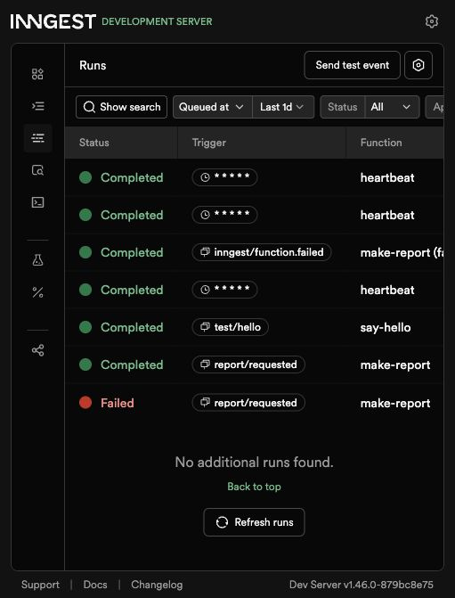

# Your first background job

This standalone Express API accepts a report request immediately, then lets Inngest do the eight-second job. The report status is kept in memory, so restarting the API clears reports. The Inngest Dev Server and API both run locally without an account.

## Run locally

Use Node.js 22 or newer. From this `background-job/` folder, install the locked dependencies with `npm ci`. Start these two commands in separate terminals:

```sh
npm start
```

```sh
npm run inngest
```

The API is at `http://localhost:3000` and the Inngest dashboard is at `http://localhost:8288`. Wait for `report-api` and its three functions to appear under **Apps** and **Functions**. To run `say-hello`, open that function in the dashboard and press **Invoke**.

## API and functions

| Method | Path | Result |
| --- | --- | --- |
| GET | `/health` | `200 {"status":"ok"}` |
| POST | `/reports` | `202` with an ID and `pending` for a nonempty JSON `topic`; `400` if the topic is missing or empty |
| GET | `/reports/:id` | `200` with `pending`, `done` and a result, or `failed`; `404` for an unknown ID |
| GET/POST/PUT | `/api/inngest` | Inngest's local function registration and execution handler |

| Function | Trigger | Work |
| --- | --- | --- |
| `say-hello` | `test/hello` event | Sleeps five seconds, then returns a greeting |
| `make-report` | `report/requested` event | Sleeps eight seconds, builds a short report, and retries failures twice |
| `heartbeat` | `* * * * *` cron | Logs the counts of pending, done, and failed reports every minute |

## Measured 202 and polling proof

This local run used the same code with `PORT=3310` to avoid another service on port 3000. The POST took 0.033 seconds; the second poll followed ten seconds after the first.

```text
POST: 0.032773 seconds {"id":"a4c905c2-2ff8-4506-a40d-94dca3e07ac2","status":"pending"}
First poll: {"id":"a4c905c2-2ff8-4506-a40d-94dca3e07ac2","topic":"cats","status":"pending"}
Second poll: {"id":"a4c905c2-2ff8-4506-a40d-94dca3e07ac2","topic":"cats","status":"done","result":"Report on cats: background work completed."}
```

To reproduce it on the default port:

```sh
curl -i -X POST http://localhost:3000/reports -H 'Content-Type: application/json' -d '{"topic":"cats"}'
curl -i http://localhost:3000/reports/PASTE_ID_HERE
```

Poll the same ID again after about ten seconds. An unknown ID returns `404`.

## Failures and the clock

Posting `{"topic":"fail"}` makes `build-report` throw `The report oven is broken!`; Inngest shows attempts 0, 1, and 2 before the run ends Failed, and the report becomes `failed`. A missing topic is a permanent input error, so the API rejects it with 400 before sending an event; retrying is for work that may succeed later.

The heartbeat runs every minute without an HTTP request or event. `0 8 * * *` runs daily at 08:00, and `0 22 * * 0` runs every Sunday at 22:00; the scheduler's timezone determines which local hour those expressions mean.



The run list shows `say-hello`, a completed `make-report`, a Failed `make-report`, and heartbeat runs at 12:16 and 12:17 AM on October 11, 2026. Open the completed report run to inspect `do-the-slow-work` and `build-report`; open the failed run and expand its trace to see attempts 0, 1, and 2.
